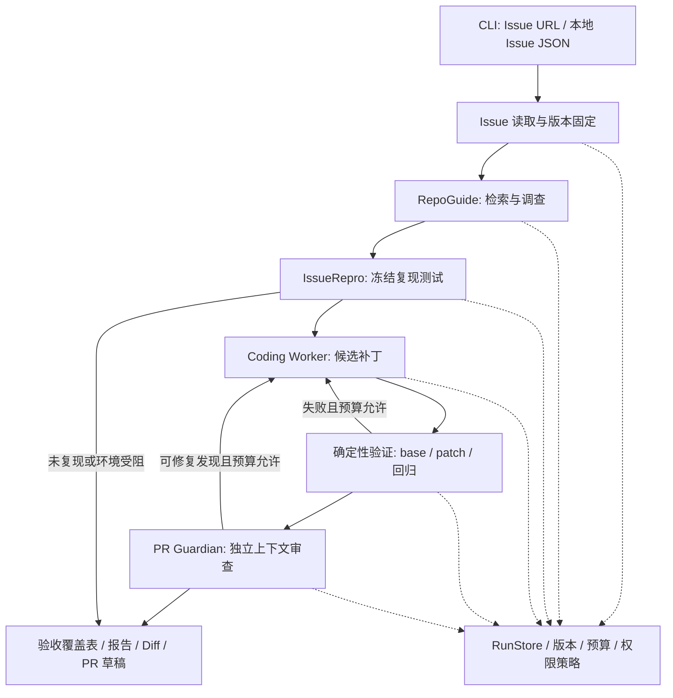

# RepoPilot 架构设计

状态：设计草案 v0.1。接口须通过 M1 适配实验验证后实现。

## 分层与职责



图中两个返工入口共用同一个修复次数和总预算。只读调查模式在 RepoGuide 后直接导出报告。

| 层 | 组件 | 负责 | 不能越权的边界 |
| --- | --- | --- | --- |
| 产品入口 | CLI / ReportBuilder | 输入、状态、恢复入口、报告 | 报告不能覆盖真实执行状态 |
| 控制面 | Orchestrator / CompletionGate | 阶段顺序、预算、权限、是否满足验收 | 模型退出信号不能直接设置成功 |
| 数据面 | RunStore / EvidenceStore | 原子检查点、产物、命令记录、摘要索引 | Agent 不得写入可信证据目录 |
| 推理 | RepoGuide / Repro / Coding / Review | 检索决策、复现假设、修复和语义审查 | 输出必须经过结构校验及证据绑定 |
| 执行 | SandboxRunner / EngineAdapter | 隔离命令、源码副本、上游引擎适配 | 只获得指定源码和阶段所需权限 |
| 外部读取 | GitHubReader / RepositoryManager | Issue、仓库快照、base commit | 第一版不提供 GitHub 写工具 |

## 技术路线草案

- Python 产品层；运行目标优先 Linux 容器，Windows 作为当前控制端。
- mini-swe-agent v2 作为首选执行底座，单一薄适配层管理生命周期、预算和证据；不合并多个 Agent 框架。
- Pydantic 进行结构校验；CLI 可用 Typer；HTTP 只选一种成熟客户端；pytest 验证产品行为。
- 状态使用 JSON manifest + 阶段产物 + JSONL 事件，先保证单任务、单写入者；有并发需求再评估 SQLite。
- 检索先用文件清单、rg 和 Python AST。扫描源码只读文本，不通过 import 执行目标项目。
- 模型 Provider 可配置，先验证一个接口；阶段可复用同一模型，但独立构造上下文。
- 版本与依赖在 M1 小实验后锁定。本轮不创建包配置或安装依赖。

## 工作流细节

### 1. Issue 读取与仓库准备

解析 Issue URL 并读取标题、正文和必要评论；记录获取时间与原文摘要哈希。URL 要求属于允许的 GitHub 主机及 Issue 路径。先用小型只读 API 接口，MCP 作为后续适配方式。

Issue 可能指向旧版本。优先使用用户或评估样例指定的 base commit；仅有默认分支时记录所解析的 SHA 与版本假设。固定提交后才开始分析，不能将浮动分支名当证据版本。

### 2. RepoGuide

生成语言、布局、依赖文件、测试配置、入口符号与 Top-K 相关代码。每个引用绑定路径、符号或行号、版本与理由。输出中将事实、根因假设和候选测试命令分开。

检索排除 `.git/`、虚拟环境、构建输出、`planning/` 和 `.repopilot/`；限文件数、单文件大小与上下文预算。仓库较大时报告已扫描范围。

第一版只读模式采用受控文件读取、搜索工具，不给模型通用可写 shell。后续若复用引擎调查，必须用容器只读挂载和执行策略落实权限。

### 3. IssueRepro

先建立环境基线，再编写或选择能对应 Issue 行为的复现断言。生成的测试在进入修复阶段前冻结、记录内容哈希，并在 base 上运行。

失败日志必须支持目标行为；安装失败、用法错误、超时和无测试单独分类。无法形成可靠断言时导出未复现报告，保留假设与用户可补充的信息。

### 4. Coding Worker

只在受控源码副本中修改，输入为 Issue、代码依据、冻结的复现条件和实际失败。默认最多 3 次候选修复；每次候选产物绑定新摘要。

不允许通过删除断言、增加 skip/xfail、缩小测试选择或改配置绕过验收。确需修改测试时，原冻结测试仍保留在独立验证套件中，新测试改动也进入审查范围。

### 5. 验证与 PR Guardian

控制面负责在干净的 base 与候选快照上执行冻结测试，并追加指定回归集。命令开始后如果候选代码继续变化，该次结果不适用于新的候选。

Review Worker 采用新会话，接收：原 Issue、固定代码版本、必要仓库上下文、修复前失败、最终 Diff、修复后证据和验收项。不给它 Coding Worker 的自我解释或完整聊天记录。允许按路径读取候选快照，但不能修改。

独立上下文减少相互影响，不能保证审查一定正确。确定性 Gate 仍负责证据完整性；语义不明确或高风险发现转为需要人工判断。

### 6. 输出

每个模式均能导出报告；只有完整修复链满足 Gate 才报告 `resolved_verified`。报告包含复现状态、修改、验证范围、验收覆盖、审查发现和未知项。PR 内容仅为本地草稿。

## 状态模型

将“执行结束”与“问题已解决”分开：

| 维度 | 值 | 含义 |
| --- | --- | --- |
| 阶段执行 | `pending / running / succeeded / failed / interrupted / stale` | 某阶段本次尝试的执行状态 |
| Run 执行 | `created / running / waiting_input / completed / failed / budget_exhausted / interrupted` | 整个请求的生命周期 |
| 业务结果 | `investigated / reproduced / not_reproduced / environment_blocked / resolved_verified / unresolved / needs_human` | 实际做到什么 |

例如只读调查可为 `completed + investigated`；复现阶段正常执行但没复现为 `completed + not_reproduced`；预算耗尽为 `budget_exhausted + unresolved`。报表生成成功不等于修复成功。

## 持久化与恢复

1. 每个阶段使用 `run_id + stage + attempt` 标识，产物保留历史，不覆盖已提交证据。
2. 先写阶段产物临时文件并完成校验，再原子替换 manifest 检查点。事件日志记录过程；最后成功提交的 manifest 是恢复起点。
3. 单 Run 加写锁。崩溃时没有提交的尝试标为中断，不直接重放有副作用的命令。
4. Resume 校验 Issue 快照、base SHA、候选摘要、冻结测试摘要、环境/依赖摘要和策略版本。完全相符才复用阶段产物。
5. 上游输入改变则将相关下游阶段标记 `stale`，从最早受影响处生成新尝试。
6. 第一版只做阶段级恢复，不承诺恢复到任意模型工具调用中间，也不承诺外部操作恰好执行一次。

## 执行环境与权限

Git Worktree 管理本地候选版本；容器承担执行隔离。控制面维护仓库缓存和工作树，Runner 只获得不含共享 `.git` 的源码副本。导出补丁时校验路径、符号链接和文件范围，再由控制面形成可审阅 Diff。

控制端保存 GitHub 读取凭据、模型凭据、manifest 与执行记录，容器不获得宿主 HOME、Docker socket 或这些目录。命令记录由控制端执行器写出，不能直接采信目标项目自行写的“测试成功 JSON”。

容器策略草案：非特权用户、无额外 capabilities、CPU/内存与时间限制；验证阶段断网。依赖准备采用固定镜像/依赖清单，受控联网阶段结束后才进入离线测试。没有可用沙箱时保留只读调查，执行阶段报告环境受阻。

MVP 在可控测试仓库上验证这些边界；面向任意恶意代码的公开托管服务超出第一版范围。仓库文本和 Issue 被当作数据，不能更改权限、预算或触发远程写操作。

## 预算与停止

初始可调参数建议：单命令 120 秒、Run 总墙钟 20 分钟、Run 总模型请求 50 次、候选修复最多 3 次。复现和回归任务需要更长时在配置中明确放宽；数值需由样例实验校准。

总模型计数包含分析、格式重试、修复和审查。Provider 请求设置超时和输出上限；实际费用不可获得时显示未知，同时使用调用次数和 Token 预算。不能把未知费用记成零。

达到任何预算上限都保存未完成状态；环境错误与确定性命令失败不进行无界自动重试。连续相同错误和模型无进展时提前结束并报告。

## 未来源码边界（仅规划）

```text
src/repopilot/
├── cli.py
├── domain/          # 数据契约与业务状态
├── workflow/        # 阶段编排、恢复、Gate
├── github/          # Issue 只读接口
├── repository/      # 版本、文件扫描、检索、工作树
├── workers/         # 各角色输入、上下文与输出
├── engine/          # mini-swe-agent 适配
├── sandbox/         # 执行策略与可信命令记录
├── storage/         # manifest、事件与产物
└── reporting/       # 证据索引、Markdown 报告与 PR 草稿
```

先按职责保留边界，不要求第一周把所有目录都创建成完整子系统。
