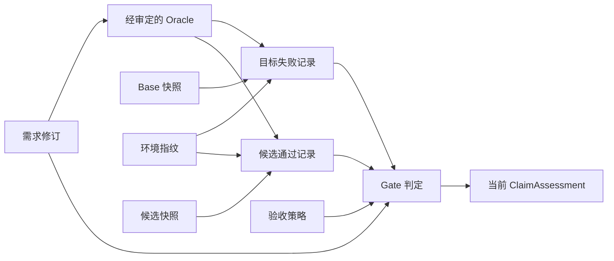

# 证据依赖图与适用性判断

状态：设计草案 v0.2，尚未实现。目标是机器可检查的证据关系与失效规则，不是程序正确性的形式化证明。

## 最小实现

采用 JSON 保存的类型化有向无环图，内存索引完成遍历；不引入图数据库、分布式图服务或函数级调用图。关系明确后再考虑存储优化。

| 节点类别 | 例子 | 谁能创建 |
| --- | --- | --- |
| 固定输入 | RequirementRevision、BaseSnapshot、CandidateSnapshot、OracleSuite、Environment、Policy | 控制面校验后登记 |
| 观察记录 | CommandEvidence、TestObservation、ReviewRecord | 可信执行器或受控 Worker 产物经校验后登记 |
| 断言 Claim | “AC-001 在候选 X、套件 T、环境 E 下得到支持” | Gate 依据固定规则生成 |
| 判定记录 | ClaimAssessment、RunAssessment | Gate；保留采用的规则和依赖集合 |

依赖边统一为 **输入 → 使用它的输出**。`requires` 边参与适用性传播；普通来源说明使用 `references`，不能混作验证支持。首版只接受预定义类型和合法边，拒绝环、缺失节点和与当前 Run 无关的引用。

实际 Gate 还依赖回归和所需语义审查。图表达依赖，不自动赋予某个测试或模型结论真实性；通过与否由固定检查规则决定。

## 输入指纹

指纹以 `SHA-256(canonical effective inputs)` 计算。结构化输入使用有版本的规范序列化；源码以明确根目录、相对路径、文件内容和影响执行的文件模式生成摘要，包含未提交修改及实际送入 Runner 的文件。Git commit SHA 保留原值，另记录源码 SHA-256，不能混为一项。

阶段键至少覆盖其真实依赖：候选源码、测试选择与内容、命令和工作目录、镜像摘要、依赖锁、影响行为的环境变量/随机种子/时间设置、Oracle 修订、相关策略版本。模型阶段另外记录模型、Prompt 和生成参数版本；模型参数变化不直接否定一条仍适用于相同代码与环境的进程观察。

未受控的网络服务、时钟或外部状态必须记录为限制；输入不完整时不允许据此安全复用。仅因日志哈希一致，也不能推断命令行为确定。凭据不进入源码副本或指纹原文。

## 历史事实与当前适用性

- 原始 Artifact、观察记录和已提交判定不可覆盖。旧快照通过测试仍然是当时的事实。
- `valid / stale / unverifiable` 是相对某个目标输入集合计算的视图；`stale` 不等于历史结果变成失败。
- 当前 Claim 仅在所有必要依赖存在、摘要正确、输入匹配、Oracle 足够且 Gate 条件满足时得到支持。必要依赖缺失或无法核验时按未验证处理。
- 新候选创建新的输入节点；变更检测使使用旧节点的派生结论不再适用于当前目标，保存具体原因与最近检查时间。
- 失效传播按依赖图遍历至派生判定；不会删除无关的历史节点，也不自动无限重跑。

## 首版保守失效矩阵

| 当前目标发生的变化 | 必须重新判断的部分 | 可以保留的部分 |
| --- | --- | --- |
| Base commit 或送入 Runner 的 base 源码改变 | 代码定位、复现适用性、补丁基准和下游结论 | 历史产物，仅供审计 |
| 候选内容改变 | 全部候选测试、候选审查、最终验收 | 相同 base/Oracle/环境的失败记录 |
| Oracle、测试内容或选择改变 | 依赖该套件的 base/candidate 结果、相关审查与验收 | 补丁字节本身可保留，不能沿用旧测试判定 |
| 执行环境或实际依赖改变 | 在该环境下的运行结果及其派生结论 | 不依赖执行环境的静态代码定位 |
| 验收条件修订改变 | 需求到断言的映射与相关 Claim/Gate | 原始命令记录，仍描述旧条件下的观察 |
| 验收策略改变 | Gate 和受该策略约束的审查 | 仍满足执行策略的原始观察；执行策略也改变时重新运行受影响命令 |
| 仅原始 Issue 评论更新 | 创建新来源快照；未完成映射审定前不能自动认定语义相同 | 已明确不变的固定输入；不通过 LLM 猜测实现缓存等价 |

候选变化首版采用整个源码快照失效，哪怕只修改一行。Python 动态行为和测试配置影响范围难以静态穷尽，过早做精准缓存会产生漏失效。细粒度复用需在真实案例上证明没有错误复用，并量化节省成本后再纳入。

## 何时检测

在阶段入口、命令开始与结束、Gate、status、resume 和报告生成时检查有效输入。执行时使用固定源码副本，结束后再次核对摘要，避免“执行期间文件变动”的结果绑定错误。

第一版不承诺后台监听任意文件变化。静态报告展示 `assessed_snapshot`、`assessed_at` 与限制；用户显式执行校验后生成新的当前适用性结果。离线 HTML 不暗中执行代码或访问网络。

## 核心验收反例

1. 改候选后，旧候选测试和审查不能支持当前 Claim；base 失败记录仍可有效。
2. 只改测试选择也必须使相关测试判定失效；改回文件不能自动复用缺少完整输入指纹的记录。
3. 缺失 Artifact、哈希不符、跨 Run 伪造引用、环或非法边都不能生成通过状态。
4. 修改政策后重新计算 Gate，历史判定保留旧规则编号。
5. 报告只能陈述它绑定的版本；旧静态页面不能伪装成当前仓库状态。

对应任务：P2-07、P2-08、P3-06；实验见[评估方案](../03-plan/evaluation.md)。
