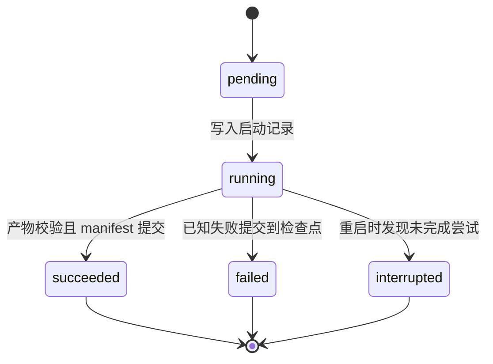

# 阶段状态、提交边界与故障恢复

状态：设计与实现边界 v0.3。M2 已实现单任务、内核单写入者锁、原子阶段提交及本地文件系统上的进程中断恢复，见 [实际记录](../04-progress/m2-stage-recovery.md)。不承诺分布式一致性或任意断电后的零数据丢失。

## 状态转换

执行状态与证据适用性分开。一次尝试的持久状态为 `pending / running / succeeded / failed / interrupted`；`valid / stale / unverifiable` 由依赖视图计算，不把一次成功执行改写成执行失败。

重试创建新的 attempt，保留旧尝试的终止原因和产物引用。预算耗尽属于 Run 停止原因，不把当前业务目标标记完成。产物已经写完但 manifest 尚未提交，执行状态仍不能视为 `succeeded`。

## 唯一提交点

1. 获取 Run 写锁并固定输入；检查单写入者条件。
2. 写入 running 检查点与开始事件，再执行阶段。
3. 将产物写入该 attempt 的临时区域，关闭/刷新文件，计算摘要并做 Schema 与路径检查。
4. 生成不可覆盖的产物及图/判定修订，准备包含完整引用的下一版 manifest。
5. 在同一文件系统内替换 manifest；**成功替换是阶段可靠提交点**，此时才登记 succeeded 或已知 failed。
6. 发布通知及追加诊断事件。通知失败不回滚已提交阶段，恢复时从 manifest 重新派生展示状态。

事件日志解释发生过什么，最后完整 manifest 决定哪些产物可用。重启时检查引用、摘要与输入；没有检查点引用的产物为 orphan，不因文件“看起来完整”就晋升为可信证据。

原子替换不是跨多个文件的事务，也不自动保证断电持久性。首版验证进程 kill 场景；刷新、目录同步和文件锁的实际行为按 Windows 控制端/所选文件系统做集成实验。需要更强持久性时再选择支持事务的存储，并迁移而不是掩盖现有限制。

## 恢复规则

| 发现情况 | 恢复行为 |
| --- | --- |
| manifest 完整、产物摘要和输入都匹配 | 复用对应已提交阶段 |
| running 尝试没有终态 | 标记 interrupted，保留部分输出，新的 attempt 再执行 |
| 产物已写但未被 manifest 引用 | 保留为 orphan，不能供 Gate 使用 |
| manifest 引用了缺失/损坏产物 | 标记 unverifiable，停止使用该分支并报告原因 |
| 输入已变更 | 保留历史成功，计算 stale，重新执行受影响阶段 |
| 提交成功但最终通知缺失 | 从 manifest 恢复完成状态，不重新运行阶段 |
| 写锁可能仍由另一个进程持有 | 验证所有者状态；不能仅按文件时间强行删除锁继续写 |

恢复后，预算累计值与已消耗的调用仍保留；无法确定是否发生的已计费请求记为不确定消耗，不能归零重试。

## 副作用分类

- 受控只读扫描：输入相同可重新执行。
- 隔离测试：在新的干净容器中重跑，保留前次不确定状态，不直接复用可写测试目录。
- 模型调用：可能已计费；使用 Provider 支持的请求关联信息，重复调用另记一次尝试，不声称恰好一次。
- 补丁生成：每次输出绑定自己的候选摘要，不在用户主工作区重放写操作。
- 远程发布：第一版无此工具。以后新增时单独设计外部状态查询和去重，不用本地检查点推断远程一定没发生。

## 故障注入矩阵

| ID | 注入点 | 必须观察到的恢复结果 |
| --- | --- | --- |
| F01 | 命令完成后、产物写入前 | 未提交结果不能视为成功；新环境重新验证 |
| F02 | 部分日志/产物写入后 | 部分文件不可被 Gate 引用，保留中断原因 |
| F03 | 完整产物写入后、manifest 替换前 | orphan 不会被误认成已提交证据 |
| F04 | manifest 替换成功后、通知前 | 阶段可复用，不重复测试或重复发布完成事件 |
| F05 | manifest/Artifact 人为损坏 | 明确 unverifiable；不能静默降级为通过 |
| F06 | 恢复前改变候选、套件或环境 | 旧结果保持历史事实，但对当前目标失效 |

先用确定性 fake Worker 和进程终止验证，再用真实 Runner 重复 F01/F03/F04。每次比较阶段执行次数、预算记录、可用证据和最终 Gate，避免只断言“能重新启动”。

对应任务：P2-05、P3-07。F01/F03/F04 已经真实 Docker + 子进程退出验证；F05 的损坏拒绝与 F06 的输入变化拒绝有离线覆盖，但动态失效、重新计算和完整真实矩阵继续在 P3 实现。当前没有 JSONL 事件流，不把普通产物或通知当作提交点。
